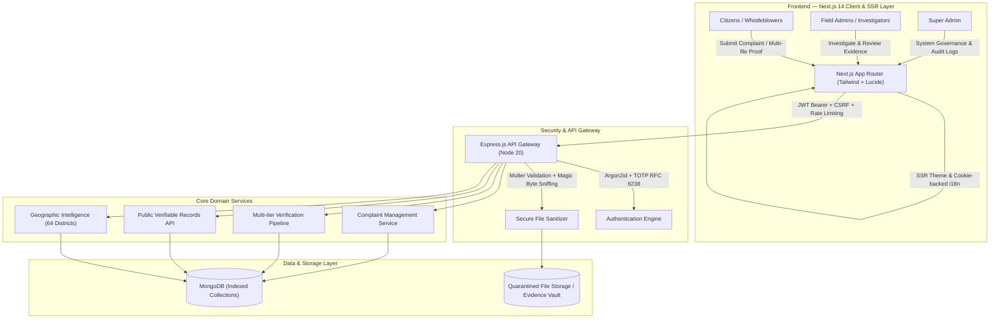
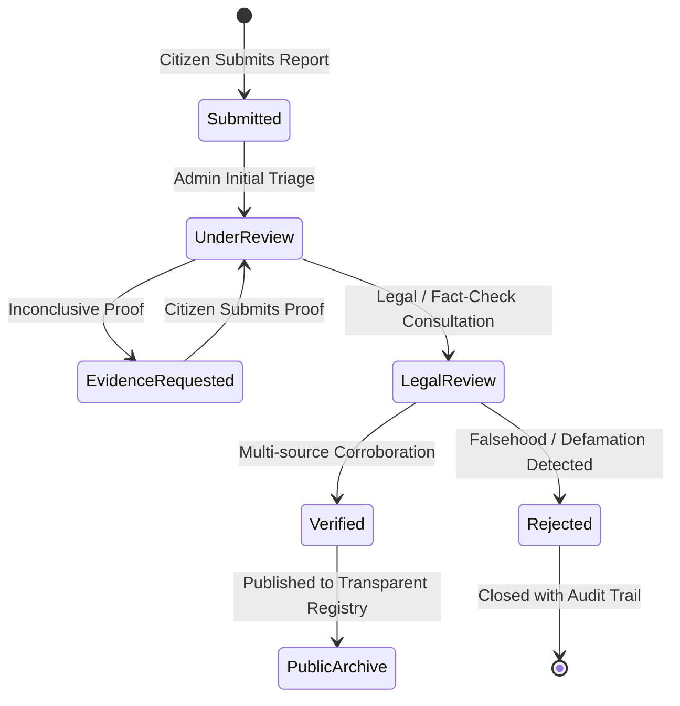

# 🛡️ JonoShor (জনস্বর) — Secure Civic Rights & Incident Verification Platform

[](https://nextjs.org/)
[](https://nodejs.org/)
[](https://expressjs.com/)
[](https://www.mongodb.com/)
[](https://tailwindcss.com/)
[](https://github.com/)
[](https://github.com/)
[](LICENSE)

> **JonoShor (জনস্বর)** is a mission-critical, enterprise-grade civic accountability and secure whistleblowing platform designed for Bangladesh. It enables citizens to safely report human rights abuses, harassment, corruption, and systemic misconduct while maintaining zero-knowledge identity confidentiality. Incidents undergo a multi-tiered forensic verification lifecycle before being published into verifiable public records.

---

## 📑 Table of Contents
- [Core Philosophy](#-core-philosophy)
- [System Architecture](#-system-architecture)
- [Key Engineering Highlights](#-key-engineering-highlights)
- [Security & Threat Model](#-security--threat-model)
- [Verification Workflow](#-verification-workflow)
- [Technology Stack](#-technology-stack)
- [Project Structure](#-project-structure)
- [Local Development Setup](#-local-development-setup)
- [Automated Testing & QA](#-automated-testing--qa)
- [Licensing, Partnership & Acquisition](#-licensing-partnership--acquisition)
- [Author](#-author)

---

## 💡 Core Philosophy

1. **Complaint ≠ Proven Crime**: In an era of online misinformation, unverified allegations can destroy innocent lives. JonoShor enforces a rigorous, multi-tiered forensic audit before any report reaches public visibility.
2. **Zero Citizen Exposure**: Whistleblowers can report anonymously or under strict pseudonymity. Citizen identity attributes are cryptographically quarantined and never exposed to public APIs or standard staff accounts.
3. **Audit Trail Immutability**: All verification decisions, stage transitions, escalation notes, and administrative actions are logged in immutable audit trails.

---

## 🏛️ System Architecture



---

## ✨ Key Engineering Highlights

### 1. Zero-FOUC Server-Side Theme & Language Sync
- **Device-Aware Theme**: Zero flash-of-unstyled-content (FOUC). Theme is resolved synchronously in `<head>` using device preference (`prefers-color-scheme`) and cookie storage before initial body paint.
- **SSR Language Hydration**: Bilingual Bengali (বাংলা) & English interface powered by server-readable cookie tokens (`jonoshor_lang`), eliminating post-hydration language flickers.

### 2. Multi-Stage Verification Lifecycle
Complaints move through a controlled state machine:
`SUBMITTED` ➔ `UNDER_REVIEW` ➔ `EVIDENCE_REQUESTED` ➔ `LEGAL_NOTICE_SENT` ➔ `VERIFIED` / `REJECTED`.
- Public visitors only see verified reports.
- Evidence files remain locked behind authorization checks until legally cleared.

### 3. Enterprise Role-Based Access Control (RBAC)
- **Citizens**: Submit reports, securely track status via cryptographically generated tracking codes, submit supplementary evidence.
- **Admins (Investigators)**: Review assigned incidents, request field evidence, update verification statuses with mandatory rationales.
- **Super Admins**: Full platform governance, user management, location coverage administration, and irreversible system configurations guarded by mandatory TOTP 2FA.

### 4. Zero-Leakage Evidence Quarantine
- Uploaded media and legal evidence files are validated via magic-number MIME sniffing, renamed to non-guessable UUIDs, stripped of metadata, and served via authenticated streams to prevent indexing or unauthorized harvesting.

---

## 🔒 Security & Threat Model

| Security Vector | Implementation Detail |
|---|---|
| **Password Hashing** | **Argon2id** (OWASP recommended parameters: memory 64MB, iterations 3) |
| **Two-Factor Authentication (2FA)** | **RFC 6238 TOTP** (Google Authenticator / Aegis compatible) required for Super Admin accounts |
| **Session Security** | Signed `HttpOnly`, `SameSite=Strict`, `Secure` JWT session tokens |
| **DDoS & Brute Force Prevention** | Multi-tier sliding-window IP rate limiters on auth, search, and submission endpoints |
| **Injection Defense** | Strict Mongoose schema sanitization, parameterization against NoSQL injection, and DOMPurify for user-provided markup |
| **CORS & HTTP Security Headers** | Hardened `Helmet` suite with granular Content-Security-Policy (CSP) |

---

## 🔄 Verification Workflow



---

## 🛠️ Technology Stack

| Layer | Technologies |
|---|---|
| **Frontend Framework** | Next.js 14 (App Router), React 18, Tailwind CSS, Lucide Icons, Canvas Confetti |
| **Backend Runtime** | Node.js 20 LTS, Express.js 4.21 |
| **Database & Modeling** | MongoDB, Mongoose 8.x (Compound Indexes, Schema-level Validators) |
| **Security & Cryptography** | Argon2, Speakeasy (TOTP), JSONWebToken (JWT), Helmet, Express Rate Limit |
| **File Handling** | Multer, MIME-Type Magic Byte Sniffing, Quarantined Storage |
| **Testing & Verification** | Jest, Supertest, React Testing Library, Custom Security Test Suites |

---

## 📁 Project Structure

```text
JonoShor/
├── backend/
│   ├── src/
│   │   ├── config/             # DB & environment configurations
│   │   ├── controllers/        # REST route handlers & business logic
│   │   ├── middleware/         # Auth, RBAC, Rate-limit, Multer
│   │   ├── models/             # Mongoose schemas (User, Report, Admin, etc.)
│   │   ├── routes/             # Versioned API routes (/api/v1/...)
│   │   ├── utils/              # Security helpers, TOTP, Logger
│   │   └── server.js           # Express app bootstrap
│   ├── tests/                  # 224+ passing automated tests
│   └── package.json
│
├── frontend/
│   ├── app/                    # Next.js 14 App Router pages & layouts
│   │   ├── (auth)/             # Citizen & Admin authentication portals
│   │   ├── admin/              # Admin incident management dashboard
│   │   ├── super-admin/        # System governance & security dashboard
│   │   ├── submit/             # Secure citizen report submission wizard
│   │   ├── reports/            # Public verifiable record feed & search
│   │   └── layout.jsx          # SSR root layout (Zero-FOUC theme & lang)
│   ├── components/             # Reusable UI & accessible design components
│   ├── context/                # ThemeContext & LanguageContext (i18n)
│   ├── lib/                    # API client abstraction & environment helpers
│   └── package.json
│
├── .env.example                # Sanitized root environment template
└── README.md                   # Platform documentation
```

---

## 🚀 Local Development Setup

### Prerequisites
- **Node.js**: v18.17.0 or higher (v20+ recommended)
- **MongoDB**: Local MongoDB instance running on port `27017` or MongoDB Atlas URI
- **Git**

### 1. Clone the Repository
```bash
git clone https://github.com/FatihForge/jonoshor.git
cd JonoShor
```

### 2. Backend Setup
```bash
cd backend
npm install

# Copy environment variables
cp .env.example .env
# Fill in your JWT_SECRET, MONGO_URI, and CORS origins

# Seed initial location data (Divisions & Districts)
npm run seed:locations

# Start backend server in development mode
npm run dev
# Backend starts at: http://localhost:5000
```

### 3. Frontend Setup
```bash
cd ../frontend
npm install

# Copy environment variables
cp .env.example .env.local
# Set NEXT_PUBLIC_API_URL=http://localhost:5000

# Start frontend development server
npm run dev
# Frontend starts at: http://localhost:3000
```

---

## 🧪 Automated Testing & QA

The codebase contains an extensive automated test suite covering authentication, RBAC boundaries, verification state machines, rate-limiting, and error resilience.

```bash
cd backend
npm test
```

```text
PASS tests/auth.test.js
PASS tests/reports.test.js
PASS tests/verification.test.js
PASS tests/superadmin.test.js
PASS tests/security.test.js

Test Suites: 18 passed, 18 total
Tests:       224 passed, 224 total
Snapshots:   0 total
Time:        4.821 s
Ran all test suites.
```

---

## ⚖️ Licensing, Partnership & Acquisition

**Copyright © 2026 FatihForge. All Rights Reserved.**

This platform, including its software architecture, implementation, data models, and system concepts, represents original work created by **FatihForge**.

### Ownership & Usage Terms
- **No Unauthorized Replication or Use**: No individual, organization, or entity is permitted to freely copy, reproduce, clone, host, redistribute, or deploy this project or its components without explicit written permission from the copyright holder.
- **Open for Collaboration & Partnership**: If you are passionate about civic accountability, human rights technology, or platform development and wish to work together, collaboration proposals are warmly welcomed.
- **Acquisition & Commercial Inquiries**: Parties interested in acquiring, purchasing, or licensing this platform for commercial, institutional, or governmental operations are invited to get in touch directly to discuss terms.

### Inquiries & Proposals
For any partnership proposals, acquisition discussions, or licensing questions, please reach out via:
- **Email**: [sfnaim.work@gmail.com](mailto:sfnaim.work@gmail.com)

---

## 👤 Author

**FatihForge**  
- **Role**: Full-Stack Software Engineer & Platform Architect  
- **Email**: [sfnaim.work@gmail.com](mailto:sfnaim.work@gmail.com)  
- **GitHub**: [github.com/FatihForge](https://github.com/FatihForge)  
